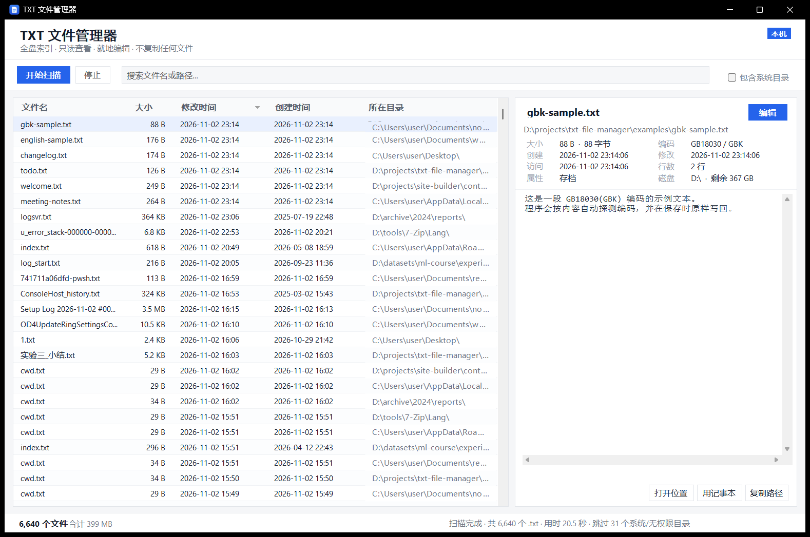
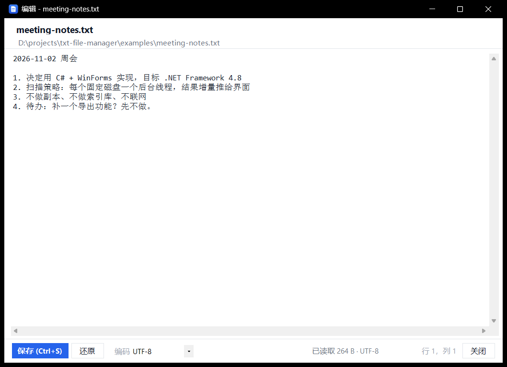

# TXT 文件管理器 · txt-file-manager

[](LICENSE)
[](#系统要求)
[](#系统要求)
[](../../actions/workflows/build.yml)

一个原生 Windows 桌面小工具：**一次扫描本机所有磁盘，列出全部 `.txt` 文件**，在表格里浏览、查看完整详情、预览内容，并**就地编辑**（直接写回原文件）。

不联网、不建索引库、**不复制、不移动、不重命名任何文件**。整个程序就是一个 350 KB 的 exe，不需要安装、不需要 .NET SDK、不写注册表。



> 截图中的路径已替换为示例数据。

---

## 为什么做这个

Windows 自带的搜索对"找全某类文本文件"并不好用：要等 Windows 索引、经常漏掉其他磁盘、双击后也不知道文件到底有多大、什么编码。

这个小工具只想解决一件事：**把本机所有 txt 摊开给你看，并且随手就能改。**

设计上的三个硬约束：

| 约束 | 含义 |
| --- | --- |
| **不复制** | 全程只做「读」和「原地写回」，没有"另存为 / 导入 / 回收站"这类会产生副本的逻辑 |
| **不联网** | 没有任何网络请求、没有遥测、没有自动更新 |
| **不留垃圾** | 不写注册表、不装服务、不在 `%APPDATA%` 留配置，删掉程序即彻底干净 |

---

## 功能

- **全盘检索**：扫完后按修改时间倒序，几万个文件也不卡（虚拟模式列表）。
- **一目了然**：文件名 · 大小 · 修改时间 · 创建时间 · 所在目录，表头点击排序。
- **详情面板**：完整路径、**精确字节数**、编码、创建 / 修改 / 访问时间、行数、属性、所在磁盘与剩余空间。
- **内容预览**：直接读文件头部（最多 256 KB）显示，超长会提示。
- **就地编辑**：内置编辑器，**自动识别并保持原编码**（UTF-8 / UTF-8 BOM / GB18030 / UTF-16 LE）与**原换行符**（CRLF / LF），`Ctrl+S` 直接覆盖原文件。
- **搜索过滤**：输入即筛（文件名或路径），无需等扫描结束。
- **系统目录可选**：默认跳过 `C:\Windows` 等系统目录，勾选后也纳入扫描。

---

## 快速开始

### 方式一：直接用编译好的 exe（推荐）

1. 到 [Releases](../../releases) 下载 `TxtManager.exe`；
2. 双击运行——启动后会自动开始扫描本机固定磁盘（约 10–20 秒，视文件数量而定）；
3. 想固定到桌面就自己发个快捷方式，程序本身不写任何外部位置。

无需安装、无需解压其它文件（单个 exe 即可运行）。

### 方式二：自己编译

```powershell
git clone https://github.com/lfkidiejfhfud55ffll/txt-file-manager.git
cd txt-file-manager
powershell -NoProfile -ExecutionPolicy Bypass -File .\build.ps1
```

产物：`dist\TxtManager.exe`。

编译只需要 **Windows 自带的 `csc.exe`**（.NET Framework 4.x 自带），不需要 Visual Studio、不需要 .NET SDK、不需要联网。

---

## 使用说明

### 快捷键

| 按键 | 作用 |
| --- | --- |
| `Ctrl + F` | 聚焦搜索框 |
| `F5` | 重新扫描 |
| `Enter` / 双击 | 用内置编辑器打开选中文件 |
| `Ctrl + C` | 复制选中项的完整路径 |
| `Ctrl + S`（编辑器内） | 保存并覆盖原文件 |

### 详情面板的三个动作

- **打开位置**：在资源管理器中定位并选中该文件（`explorer /select`）。
- **用记事本**：交给系统记事本。
- **复制路径**：把完整路径放进剪贴板。

### 编辑器



- 打开时自动探测编码，标题栏无 `*` 表示无改动；有改动时标题会加 `*`，关闭时提示保存。
- 保存 = `File.WriteAllText(原路径, 内容, 原编码)`，**不产生副本、不产生 .bak**。
- 若文件在此期间被外部修改过，保存前会提示冲突。
- 只读属性的文件会提示（保存会失败，需先去掉只读）。

---

## 系统要求

- Windows 10 / Windows 11（自带 .NET Framework 4.8）。
- Windows 7 SP1 / 8.1 需要自行安装 [.NET Framework 4.8](https://dotnet.microsoft.com/download/dotnet-framework/net48)。
- 只支持 Windows：界面基于 WinForms，并且用到了 `%WINDIR%\Microsoft.NET\Framework64\v4.0.30319\csc.exe` 做零依赖编译。

---

## 技术说明

- **语言 / 框架**：C# 5 + WinForms，目标 .NET Framework 4.8，`/target:winexe` 单文件输出。
- **为什么不用 .NET SDK / WPF**：为了让"克隆下来就能编、编完就一个 exe"，直接用系统自带的老 csc 最省事，产物也最小。
- **扫描**：每个固定磁盘起一个后台线程做 BFS 遍历，结果通过共享队列增量推给界面，界面用虚拟模式 `DataGridView`（`VirtualMode` + `CellValueNeeded`），6 万行也不卡。
  - 默认跳过：`$Recycle.Bin`、`System Volume Information`、`WinSxS`、`$Windows.~BT`、`$Windows.~WS`、`Recovery`、`Config.Msi`、`WindowsApps`、`Installer`，以及（未勾选时）整个 `C:\Windows`。
  - 跳过符号链接 / 联接点，避免目录环；无权限目录静默跳过并计数，状态栏可见。
- **编码探测**：BOM → UTF-16 零字节启发 → 严格 UTF-8 校验 → GB18030 兜底（`src/TextCodec.cs`）。
- **保存**：按打开时探测到的编码与换行符写回，避免"用 UTF-8 打开 GBK 文件再保存变成乱码"这类经典事故。

---

## 目录结构

```
txt-file-manager/
├─ src/                     全部源码（C# 5 / WinForms）
│  ├─ Program.cs            入口（含 --selftest 自测分支）
│  ├─ MainForm.cs           主窗口：工具栏 / 虚拟列表 / 搜索 / 扫描控制
│  ├─ PreviewPane.cs        右侧详情与内容预览
│  ├─ EditorForm.cs         编辑器窗口
│  ├─ ScanEngine.cs         多线程全盘扫描引擎
│  ├─ TextCodec.cs          编码探测 / 读写
│  ├─ Model.cs              数据模型与格式化
│  ├─ Ui.cs                 配色、按钮、卡片等自绘控件
│  ├─ SelfTest.cs           自测（扫描 + 编码往返）
│  ├─ AssemblyInfo.cs       版本信息
│  └─ app.ico               程序图标
├─ examples/                示例 txt（用来试预览和编辑）
├─ docs/                    截图 + 发布清单（PUBLISH.md）
├─ tools/gen_icon.py        用纯标准库重新生成 app.ico
├─ build.ps1                一键编译
├─ publish.ps1              一键发布到 GitHub
└─ .github/workflows/       CI：编译 + 自测 + 打 tag 自动发 Release
```

---

## 自测

```powershell
.\dist\TxtManager.exe --selftest
```

覆盖：目录扫描、UTF-8 / UTF-8 BOM / GB18030 / UTF-16 LE 四种编码探测、保存回读校验。末行输出 `RESULT: PASS` 或 `RESULT: FAIL`，退出码即结果。

---

## 发布到 GitHub

本目录已经是一个"可发布状态"的仓库：`LICENSE`、`.gitignore`、CI 都在位，`dist/` 与临时文件已被忽略。

```powershell
# 1. 先在 GitHub 网页上建一个空仓库（不要勾 README / .gitignore / LICENSE）
# 2. 安装 Git for Windows，然后在新的终端里：
powershell -NoProfile -ExecutionPolicy Bypass -File .\publish.ps1 -RepoUrl https://github.com/你的名字/txt-file-manager.git
```

脚本会完成 `git init → config → add → commit → remote add → push`。
之后打 tag 即可自动发 Release（CI 编译 + 附上 exe）：

```powershell
git tag v1.0.0
git push origin v1.0.0
```

---

## 已知限制

- 只索引 `.txt`（不区分大小写）；`.text` / `.log` 等不在列表内。
- 大于 4 MB 的文件打开编辑器前会二次确认；预览始终只读前 256 KB。
- 极长路径在「所在目录」列显示省略号，完整路径看右侧详情。
- 扫描目录树时不做内容索引，所以"按内容搜索"没有实现。
- 界面为中文，暂无多语言。

---

## English

A tiny native Windows tool that scans **all fixed drives for `.txt` files**, lists them in a virtualized grid (size / modified / created / folder), shows full metadata + a content preview, and lets you **edit the file in place** while preserving its original encoding and line endings.

- Single ~350 KB `.exe`, no installer, no dependencies beyond the bundled .NET Framework 4.8.
- **Never copies, moves or renames anything** — read + in-place write only. No network, no telemetry, no registry, no config files.
- Build with the built-in `csc.exe`: `powershell -File .\build.ps1`. No SDK required.
- UI is Chinese; `Ctrl+F` search, `F5` rescan, `Enter` open editor, `Ctrl+S` save.

---

## License

[MIT](LICENSE)
